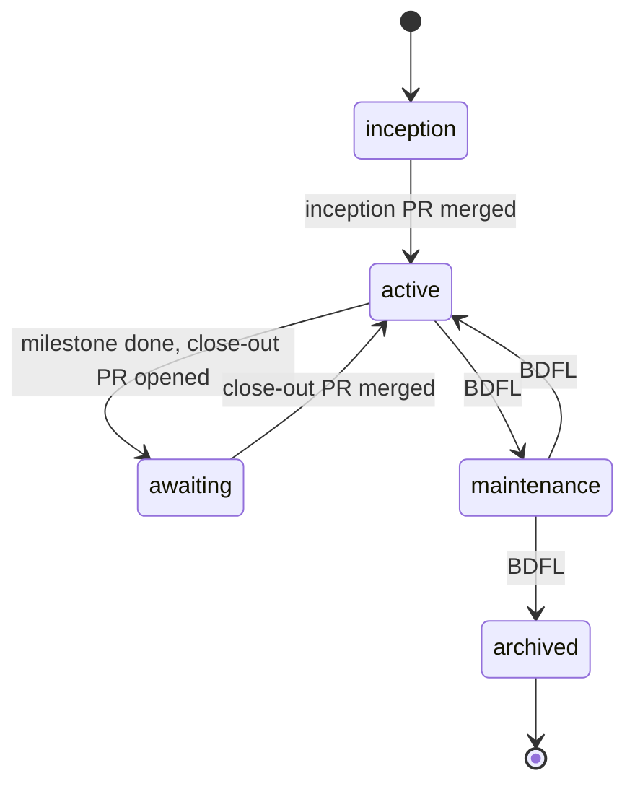

# Overview

Normative.

## Purpose

A process for one human architect directing AI agents across many repositories. It fixes who decides what, where project state lives, how work moves from idea to release, and how the architect stays informed without supervising.

## Roles

| Role | Who | Responsible for |
|---|---|---|
| BDFL | Antonio | Vision, gated decisions, acceptance |
| Agent | Claude Code sessions acting as the agent identity | Decomposition, implementation, upkeep of ungated docs, drafts of gated changes |
| Design session | claude.ai project chats with the BDFL | Drafts of gated documents, delivered by handoff |

Agents never act as the BDFL's GitHub account ([ADR-0012](../adr/0012-agent-identity.md)).

## Authority

Every change is gated or ungated.

- **Gated**: merges only with BDFL approval. Agents may draft gated changes, never merge them.
- **Ungated**: agents decide and merge on green CI, noting non-obvious choices in the PR.

| Gated | Location |
|---|---|
| Vision, non-goals, project status | `VISION.md` |
| Architecture decisions | `docs/adr/` |
| Large proposals | `docs/rfc/` |
| Milestone scope, close-out, roadmap | `docs/milestones/`, `ROADMAP.md` |
| Public API | per profile |
| Dependencies | per profile |
| Releases | release PRs, version fields, tags |
| Process and enforcement | `AGENTS.md`, `CLAUDE.md`, `.mandate/`, `.github/` |

The last row follows from the others: an agent able to edit its own rules or CI could bypass every gate.

Ungated: code and tests within the active milestone, `docs/architecture.md`, `docs/design/`, `README.md`, the Unreleased section of `CHANGELOG.md`, issues, labels.

Unsure whether a change is gated: treat it as gated.

## Lifecycle

| State | Agents may | Leaves when |
|---|---|---|
| inception | process `handoff` issues | BDFL merges `VISION.md` (status active), first ADRs, milestone 001 |
| active | work the active milestone | every milestone issue is closed and agents open the close-out PR |
| awaiting | revise the close-out PR | BDFL merges it |
| maintenance | fix `bug` issues; no milestones | BDFL changes status |
| archived | nothing | never |

`handoff` issues are processed in every state except archived.

`VISION.md` stores inception, active, maintenance and archived. `awaiting` is derived: status active and no open GitHub milestone. `mandate status` computes it.

Releases are not a state; a release PR can be opened from active or maintenance ([workflow](workflow.md#releases)).
